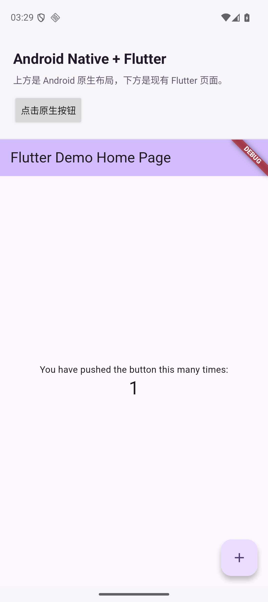

# Android Native + Flutter 混合工程

原生 Android 宿主通过 Gradle 源码依赖接入现有 Flutter 页面。
启动宿主后，上方显示原生标题和按钮，下方通过 `FlutterFragment` 显示根目录
`lib/main.dart` 中的 Flutter 计数器页面，两部分处于同一个原生 Activity 中。

## 工程结构

```text
my_app_douyin/
├── lib/main.dart                # 原有 Flutter 入口和页面，继续在这里开发
├── android/                     # 原有 Flutter App 的 Android 工程
├── flutter_module/              # 新建的 Flutter Module 接入层
│   ├── pubspec.yaml             # 通过 path: .. 依赖原有 Flutter 工程
│   ├── lib/main.dart            # 委托给原有 Flutter main()
│   └── .android/                # flutter pub get 自动生成，不提交、不手改
└── native_android/              # 新建的 Android 原生宿主，Android Studio 打开此目录
    ├── settings.gradle          # 引入 Flutter Module，注册 :flutter
    ├── build.gradle             # Android 插件版本（使用 AGP 内置 Kotlin）
    └── app/
        ├── build.gradle         # implementation project(':flutter')
        └── src/main/
            ├── kotlin/.../MainActivity.kt
            └── res/layout/activity_main.xml
```

原有工程仍可独立运行。新增 Module 只负责提供 add-to-app 入口，没有复制 Flutter 页面。
宿主包名为 `com.example.douyin.nativehost`，与 Module 的 Android 包名不同。

## 环境

当前配置对应 Flutter 3.47.1 / Dart 3.13.1、AGP 9.1.0、Gradle 9.3.1，
使用 AGP 内置 Kotlin，并将其编译器依赖升级为 2.4.0 以满足 Flutter 的版本检查。
使用 JDK 17 或 21，安装 Android SDK Platform 36 和 NDK 28.2.13676358。
宿主最低支持 Android 7.0（API 24）。

## 首次准备

在项目根目录执行：

```bash
flutter pub get
cd flutter_module
flutter pub get
cd ..
```

第二次 `flutter pub get` 会生成宿主依赖的 `.android/include_flutter.groovy`。
拉取代码、切换 Flutter SDK 或更新 Flutter 依赖后，先重新执行这一步，再同步 Gradle。

本机的 `native_android/local.properties` 已配置 Android SDK 路径。
换到其他机器时，如果没有这个文件，复制示例并把 `sdk.dir` 改为该机器的 SDK 绝对路径：

```bash
cp native_android/local.properties.example native_android/local.properties
```

`local.properties` 不提交到版本控制。Flutter SDK 路径由 Module 执行
`flutter pub get` 时自动记录在 `.android/local.properties` 中。

## 构建和运行原生宿主

在 Android Studio 中打开 **`native_android/`**，等待 Gradle Sync 完成，选择 `app` 运行到设备。

也可以在项目根目录使用命令行：

```bash
cd native_android
./gradlew :app:assembleDebug
# 连接 Android 手机或启动模拟器后：
./gradlew :app:installDebug
adb shell am start -n com.example.douyin.nativehost/.MainActivity
```

APK 位于 `native_android/app/build/outputs/apk/debug/app-debug.apk`。
Release 构建使用 `./gradlew :app:assembleRelease`；正式分发前需配置自己的签名。
宿主也定义了 `profile` 构建类型，与 Flutter Module 的构建类型保持一致。

## Flutter 热重载

先运行原生宿主，再在 **`flutter_module/`** 下连接其 Dart VM：

```bash
cd flutter_module
flutter attach --app-id com.example.douyin.nativehost -d <设备ID>
```

设备 ID 可用 `flutter devices` 查看。修改根目录 `lib/` 后，在 attach 终端按 `r` 热重载，
按 `R` 热重启。新增原生代码或插件需要重新构建并运行宿主。

## 接入实现

- `native_android/settings.gradle` 应用 Module 生成的 `include_flutter.groovy`，
  自动引入 `:flutter`、Flutter 插件和 Flutter Gradle 插件构建。
- `native_android/app/build.gradle` 用 `implementation project(':flutter')` 将
  Flutter 引擎、Dart 代码和资源打包进宿主 APK，原生 app 不应用 Flutter app 插件。
- 原生 `MainActivity` 继承 AndroidX `FragmentActivity`，在 XML 布局的
  `FragmentContainerView` 中创建 `FlutterFragment`，使用 texture 渲染模式。
- Activity 向 Flutter 转发生命周期相关回调、Intent、权限结果和 Activity 结果，
  FlutterFragment 自动处理系统返回；恢复 Activity 时复用 FragmentManager 恢复的实例。
- `settings.gradle` 使用 `PREFER_SETTINGS` 管理依赖仓库，并支持
  `FLUTTER_STORAGE_BASE_URL` 环境变量配置 Flutter 镜像。

## 验证命令

```bash
flutter analyze
flutter test
cd flutter_module
flutter analyze
flutter test
cd ../native_android
./gradlew :app:assembleDebug :app:lintDebug
```

官方参考：[源码接入 Android 宿主](https://docs.flutter.dev/add-to-app/android/project-setup)、
[在原生页面中嵌入 FlutterFragment](https://docs.flutter.dev/add-to-app/android/add-flutter-fragment)。

## 已验证

- 根目录与 Flutter Module 的 `flutter analyze`、`flutter test` 均通过。
- 原生宿主 `:app:assembleDebug`、`:app:lintDebug` 通过。
- 在 API 36 模拟器运行，原生 Toast、Flutter 计数器点击、后台恢复、系统返回、重新进入和热重载均正常。

实际运行截图：


